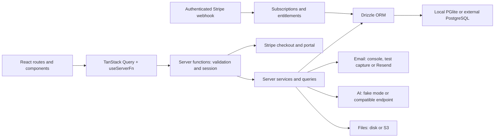

# Finance Tracker architecture

Inspected on October 28, 2026 at received commit `275a04a81c1fee990a1b37f4769c3c2c58a9c026` of [Railsreactor/agentic-interview-task-finance-tracker](https://github.com/Railsreactor/agentic-interview-task-finance-tracker). This baseline description is supplemented by the implemented budgets feature below. The budget implementation extends this baseline as described below.

## Application structure

A single TypeScript application uses React 19 and TanStack Router/Start for pages and server communication, with Vite/Nitro producing the Node server. No separate backend needs to be built for this assignment.

The normal flow is route → TanStack Query/useServerFn → createServerFn → session/input validation → queries. Some received `.functions.ts` files contain queries directly; new features should separate RPC wrappers from testable `.server.ts` helpers.

| Layer | Responsibilities and entry points |
| --- | --- |
| Pages | `src/routes/`: dashboard, accounts, categories, transactions, imports, categorization, receipts, settings and billing. `_authed.tsx` redirects unauthenticated visitors. |
| Navigation/UI | `src/components/sidebar.tsx`, Radix/shadcn components in `src/components/ui/`, Tailwind styles. |
| Remote state | `src/router.tsx` integrates SSR and QueryClient; authenticated pages use queries, mutations and invalidation. |
| RPC | `src/server/*.functions.ts`: createServerFn, Zod validation and user identity. |
| Domain/integrations | `src/server/*.server.ts` and specific modules: analytics, billing, compliance, AI quotas and providers. |
| Persistence | `src/db/schema.ts`, `src/db/index.ts`, `src/db/migrate.ts`, `drizzle/`: schema, driver selection and startup migrations. |
| Internationalization | `messages/en.json` feeds generated Paraglide messages in `src/paraglide/`; UI copy uses `m.*`. |

UI routes must not import DB, session or server-only modules directly. Server-only HTTP endpoints, such as Stripe webhooks, have a different boundary. Consult official TanStack Start documentation before implementation.

## Data model

- Identity: `users`, `auth_tokens` and a `sessions` table. Observed authentication uses a useSession cookie checked against the user and session_version; the table's existence does not make it the active session mechanism.
- Finance: user-owned `accounts` specify currency; `transactions` reference an account, optional category and optional import batch.
- Categories: a user-scoped parent_id tree; updates reject cycles and deletion handles descendants and transaction reassignment.
- Receipts: directly user-owned `receipts` can reference a transaction; `receipt_items` contain separate amounts and categories.
- Imports/AI: `import_batches`, `categorization_rules`, `ai_usage`.
- Plans: `subscriptions` mirror subscriptions; `stripe_events` deduplicate processed events.

Money uses integer minor units (`amount_minor`) and shared helpers in `src/lib/money.ts`. Expenses are negative, income positive. Transaction dates are SQL DATE values. The baseline schema had no budgets table; the implementation adds budgets and notification claims.

`src/db/index.ts` selects external PostgreSQL with DATABASE_URL, persistent PGlite at `data/pg` otherwise, and in-memory PGlite with TEST_MODE=1 (which overrides DATABASE_URL). PGlite uses PostgreSQL semantics, not SQLite. Migrations share the PostgreSQL dialect.

## Existing integrations

Transactions support manual CRUD, filtering and pagination. CSV import includes preview, deduplication, categorization rules and AI assistance. Saving a receipt can also create a transaction. All relevant mutation paths need budget reconciliation.

`analytics.server.ts` calculates income, expenses, category totals, monthly series and Sankey data. Totals use transactions; Sankey also uses receipt items. Budget calculations must declare their source to avoid counting the same purchase twice.

`billing.server.ts` centralizes getEffectivePlan/getEntitlements. No subscription means Free; Pro entitlements apply to active, trialing and past_due subscriptions. Stripe checkout, portal and webhook already exist. Existing entitlements cover accounts and receipt scans; add a budget cap rather than a new payment system.

`email.ts` provides sendEmail with console, in-memory test capture and Resend providers. It currently has no idempotency-key parameter. Budget alert deduplication and failure semantics need explicit design.

Session authorization uses requireUserId; ownership helpers scope queries by ID and user. `start.ts` handles request context, errors, CSRF protection and headers. `compliance.server.ts` exports ZIP/JSON/CSV and deletes accounts after a 14-day grace period; raw AI responses have 90-day retention. Its hourly sweep is an in-process timer started on the first request, not a durable external worker.

Operations include Pino, optional Sentry, health endpoints, a Dockerfile and local/S3 receipt storage. The sample MCP todo endpoint is unrelated to budgets.

## Development and tests

Use Node 22+ and pnpm 10.33.0. Development uses persistent PGlite, while Playwright owns a production build with in-memory PGlite, fake AI and captured email. Fresh development databases use `/setup`.

See [testing and local setup](../testing.md) for commands, isolation requirements and the current verification result. E2E tests are in `tests/e2e/`, configured by `playwright.config.ts`; fixtures create independent users for parallel tests.

## Documentation and scope

The received Git tree had no `docs/`, ADR or implementation-plan directory. These docs were added locally. Upstream references to `features/104`, `features/105`, `docs/self-hosted-llm.md` and `todo.md` point to files absent from this checkout.

The original preparation did not change application logic; the subsequent budget implementation does. See [requirements](../features/monthly-category-budgets.md) and the [implementation plan](../plans/2026-10-28-monthly-category-budgets.md), including acceptance criteria mapped to E2E tests.

## Budget feature added after baseline inspection

New `budgets` and `budget_notifications` tables support recurring category limits and persistent monthly alert claims. `budgets.server.ts` aggregates expenses by category/currency and resolves descendants; `budgets.functions.ts` exposes authenticated CRUD. `budget-alerts.server.ts` runs after relevant mutations, and existing compliance services export/delete the new records. `categories.server.ts` now owns tested category deletion, including ownership checks before cascades.

The Budgets route reuses existing UI components and query patterns, with explicit form labels, keyboard dialogs, announcements and currency-aware displays. A per-user test clock supports isolated month-boundary browser tests; normal deployments always use real time. See the implementation plan for the final validation record, including accessibility evidence and the email delivery tradeoff.

Current verification evidence is recorded in the [submission review](../reviews/2026-10-28-submission-review.md).
